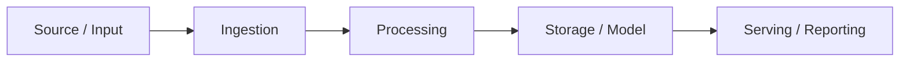

# [Project Name]

[One sentence: what the system does and why it exists.]

> **10-second summary:** [problem → system → strongest concrete evidence].

> **Scope boundary:** [what this project is NOT; academic / PoC / local / synthetic / not production-ready].

## Problem / Goal

[What real or realistic problem is being solved? What was the engineering objective?]

## Architecture



[Link an editable Draw.io source or rendered architecture image when available.]

## Dataset / Workload

| Item | Value |
|---|---:|
| Source(s) | [source names] |
| Rows / events | [measured value] |
| Time range | [measured range] |
| Grain | [explicit grain] |

State clearly whether this is a learning dataset, synthetic dataset, measured runtime evidence, or production workload.

## Recruiter Snapshot

| System role | Implemented evidence |
|---|---|
| **Connect / Ingestion** | [APIs, files, DB, scraping, etc.] |
| **Buffer / Messaging** | [Kafka/RabbitMQ/etc. or "not implemented"] |
| **Processing** | [Python/SQL/Spark/etc.] |
| **Storage** | [DB/object storage/files] |
| **Modeling / Serving** | [warehouse/model/API/report] |
| **Data Quality / Validation** | [tests, rules, checks] |
| **Orchestration** | [Airflow/Prefect/n8n/etc. or "not implemented"] |
| **Observability** | [logs/metrics/monitoring or explicit limitation] |
| **Infrastructure** | [Docker/Cloud/IaC] |

## What Is Implemented

- [concrete capability]
- [concrete capability]
- [concrete capability]

Avoid listing planned architecture as completed evidence.

## Reproduce / Run

```bash
# minimal reproducible path
[commands]
```

A reviewer should be able to understand how to run or verify the project without reverse engineering the repository.

## Validation Evidence

- [tests / quality checks]
- [row-count reconciliation]
- [CI result]
- [smoke test / screenshots / demo]

Prefer measured evidence over adjectives such as "robust", "secure" or "production-ready".

## Engineering Decisions

### [Decision 1]

**Context:** [why a choice was necessary]  
**Decision:** [what was chosen]  
**Trade-off:** [what is gained/lost]

### [Decision 2]

**Context:** [...]  
**Decision:** [...]  
**Trade-off:** [...]

## What Broke / Failure Modes

Document only real observed failures or explicit system failure modes.

- [problem/failure]
- [how it was diagnosed]
- [what changed]
- [what remains unresolved]

Do not invent dramatic failures for storytelling.

## What I Learned

Focus on transferable engineering judgment, not course notes:

- [lesson about grain / contracts / failure handling / reproducibility / architecture]
- [lesson about design or operational behavior]
- [lesson about what you would do differently in production]

## Constraints and Production Gaps

- [academic / synthetic / local-only constraint]
- [missing orchestration/monitoring/security control]
- [scale not tested]
- [mocked external system]
- [known semantic limitation]

A limitation stated clearly usually increases credibility more than a vague production-readiness claim.

## Evidence Navigation

1. [architecture]
2. [tests / validation]
3. [data model / contracts]
4. [screenshots / demo]
5. [runbook]
6. [learning / decisions]

## Attribution

If the project is based on a tutorial, course, dataset or reference implementation, state that clearly and distinguish:

- supplied scenario / baseline
- your implementation
- your validation
- your documentation
- your refinements

## TL;DR

[2–4 sentences: what the project proves, what it does not prove, and why a technical reviewer should care.]
